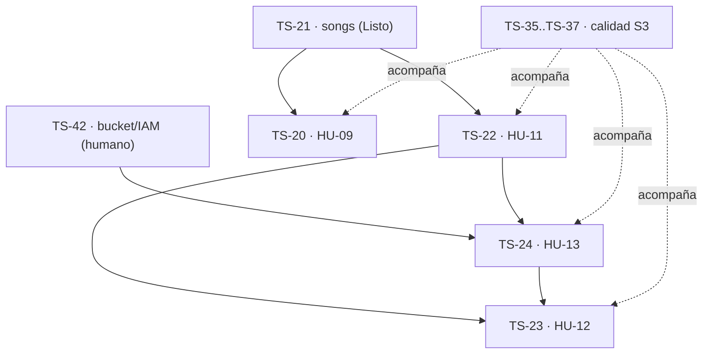

# Sprint 3 - Canciones y subida de audio

**Estado:** planificado el 2026-10-15. `TS Sprint 3` (id 38) creado en Jira; Jira manda sobre estado, checklist y criterios de aceptación.
**Ventana:** 2026-10-19 a 2026-10-30. **Release:** R1 - Núcleo interno (MVP). Arranca tras la revisión del S2 con el dueño de Track Studio (lunes 2026-10-19).
**Selección funcional:** `TS-20`, `TS-22`, `TS-23` y `TS-24` (13 SP). **Reserva transversal:** 2 SP equivalentes para `TS-35`..`TS-37` (HU-24..HU-26), sin contar los SP dos veces.
**Tasks:** `TS-42` (bucket S3/IAM, humano), `TS-46` (evidencia de desarrollo) y el arrastre del S2. **D9.2** quedó decidida el 2026-10-15: Railway migra en cada despliegue (`migrate --force`).
**Formato:** [campos y reglas de expansión](../backlog-format.md) · catálogo en [jira-backlog.md](../jira-backlog.md) · secuencia en [roadmap.md](../roadmap.md).

## Objetivo

Entregar en staging la gestión completa de canciones dentro de una producción: el productor ve el listado con estado y posición, el sistema aplica el máximo de canciones por formato y el borrado pide confirmación y se propaga en cascada. Además, el productor sube un archivo WAV/MP3 de hasta 500 MB a una nueva versión, directo a S3 y con el progreso visible.

## Capacidad y compromiso

| Tipo                  | Alcance                                                   |                              Capacidad |
| --------------------- | --------------------------------------------------------- | -------------------------------------: |
| Historias funcionales | HU-09 y HU-11..HU-13                                      |                                  13 SP |
| Calidad transversal   | Avance verificable de HU-24..HU-26 sobre la superficie S3 |                      2 SP equivalentes |
| Tasks sin SP          | TS-42, TS-46, TS-68..TS-70 y arrastre del S2              | Consumen la misma capacidad del sprint |
| **Objetivo total**    | Funcional + transversal                                   |                 **15 SP equivalentes** |

Decisión del humano (2026-10-15): se comprometen los 13 SP completos. TS-42 es un gate humano desde el día 1.

## Registros del sprint

| Jira  | ID local | Tipo  |  SP | Título                                            | Dependencias de entrega                                 |
| ----- | -------- | ----- | --: | ------------------------------------------------- | ------------------------------------------------------- |
| TS-20 | ts-09    | Story |   3 | HU-09 Validar restricciones de formato            | TS-21 (Listo); contrato de TS-49 (`ts-09.10`)           |
| TS-22 | ts-11    | Story |   2 | HU-11 Listar canciones con estado y posición      | TS-21 (Listo)                                           |
| TS-24 | ts-13    | Story |   5 | HU-13 Subir archivos de audio a una versión       | **TS-42 (humano)**; ERD §3.5 (`create_versions_table`)  |
| TS-23 | ts-12    | Story |   3 | HU-12 Eliminar canción con confirmación y cascada | TS-22 (UI del listado) y tabla `versions` de TS-24      |
| TS-42 | ts-31    | Task  |   — | Provisionar bucket S3 e IAM en us-east-1          | Acción humana externa; D7.1-D7.7                        |
| TS-46 | ts-35    | Task  |   — | Tesis: evidencia de desarrollo por sprint         | Evidencia de las entregas                               |
| TS-68 | ts-39    | Task  |   — | UI Figma: base (tokens y shell con navegación)    | —                                                       |
| TS-69 | ts-40    | Task  |   — | UI Figma: login, inicio, 403 y errores            | TS-68                                                   |
| TS-70 | ts-41    | Task  |   — | UI Figma: artistas (HU-05..HU-07)                 | TS-68                                                   |

## Secuencia de ejecución

Orden recomendado:

1. **Día 1:** el humano arranca TS-42. En paralelo se cierra el arrastre del S2.
2. TS-20 y TS-22 no dependen de infraestructura: van primero mientras se provisiona el bucket.
3. TS-24 empieza su spec backend en cuanto TS-22 cierre la spec. El Red/Green que toca S3 necesita TS-42 listo.
4. TS-23 al final: su cascada lógica alcanza las versiones de `versions` (TS-24).

## Fronteras de alcance

Vienen del ERD y de `CLAUDE.md` §5; no se reabren en las specs:

- **HU-13 (TS-24):** firma (reserva de `version_number`, fila `pendiente`, presigned POST de 15 min con condición de tipo y tamaño (POST desde la enmienda de D7.1 del 2026-10-20): D7.1, D7.3, D7.6 y D7.7), subida directa navegador→S3 con progreso visible (< 3 s, RNF-03) y migración `create_versions_table` con todas las columnas (ERD §3.5). **No incluye** la verificación con `HeadObject`/ETag ni el paso a `verificada` (TS-25/TS-27, S4), ni las URLs firmadas de lectura (HU-16). La spec debe definir qué ve el productor al terminar la subida mientras la versión sigue en `pendiente`.
- **HU-12 (TS-23):** borrado lógico de la canción y de sus versiones vigentes en una transacción (ERD §3.4). Los objetos de S3 se conservan hasta la purga (D4.5). La confirmación reutiliza el `AlertDialog` de HU-10 y amplía el texto con la cascada.
- **HU-11 (TS-22):** sustituye el apaño de navegación de HU-10: cada canción queda enlazada desde la producción (handoff v25 §3.2). No incluye reordenar si los AC no lo piden.
- **HU-09 (TS-20):** máximo de canciones vigentes por formato al crear una canción y al cambiar de formato. Los mínimos solo informan (contrato `ts-09.10`).
- **ADR 8.1:** las filas RBAC de `songs` y `versions` se cierran en las specs backend de HU-11 y HU-13, a partir de la sección «Autorización» del ERD.
- **ADR 8.5:** sigue sin rate limiting (ABIERTO, diferido de forma explícita).

## Condiciones de Ready

Las mismas del S2: AC vigentes en Jira, nada ABIERTO del ADR en el camino, slice del ERD aprobado (§3.4 y §3.5, cerrados el 2026-10-06), dentro de los vetos de `CLAUDE.md` §5 y spec de capa aprobada antes de los tests (C1). TS-24 añade una condición: TS-42 listo antes de su Red/Green de integración con S3.

## Desglose funcional

Los criterios de aceptación viven en Jira. Cada historia sigue el ciclo `.01`..`.09`: spec backend, tests backend en rojo, código backend (humano), review backend con C3, spec frontend, tests frontend en rojo, código frontend (humano), review frontend con C3 y comprobación en staging por el equipo, que no bloquea el Done.

### TS-20 / ts-09 - HU-09 Validar restricciones de formato

- [x] `ts-09.10` Contrato de formato aprobado en TS-49 (2026-10-05).
- [ ] `ts-09.01` Spec backend: matriz de reglas por formato, alta de canción, cambio de formato y errores D3.1.
- [ ] `ts-09.02` Tests backend en rojo: límites por formato, casos válidos, alta, edición y autorización.
- [ ] `ts-09.03` Código backend hasta verde (humano); Larastan y Pint limpios.
- [ ] `ts-09.04` Review backend con C3.
- [ ] `ts-09.05` Spec frontend: validación coherente con el backend y presentación del 422.
- [ ] `ts-09.06` Tests frontend en rojo.
- [ ] `ts-09.07` Código frontend hasta verde (humano).
- [ ] `ts-09.08` Review frontend con C3.
- [ ] `ts-09.09` Comprobación en staging por el equipo.

### TS-22 / ts-11 - HU-11 Listar canciones con estado y posición

- [x] `ts-11.01` Spec backend: listado por producción, orden por `position`, estado, autorización (fila RBAC de `songs`, ADR 8.1), vacío y no encontrado.
- [x] `ts-11.02` Tests backend en rojo: orden, estado, vacío, borradas excluidas, permisos y sin N+1.
- [x] `ts-11.03` Código backend hasta verde (humano).
- [x] `ts-11.04` Review backend con C3.
- [x] `ts-11.05` Spec frontend: listado dentro de la producción, estados de carga/vacío/error y enlace a cada canción.
- [x] `ts-11.06` Tests frontend en rojo.
- [x] `ts-11.07` Código frontend hasta verde (humano).
- [ ] `ts-11.08` Review frontend con C3.
- [ ] `ts-11.09` Comprobación en staging por el equipo.

### TS-24 / ts-13 - HU-13 Subir archivos de audio a una versión

- [x] `ts-13.01` Spec backend: firma, reserva de `version_number` con `FOR UPDATE`, fila `pendiente`, key D7.3, condiciones de la presigned POST (D7.7), errores D3.1 y fila RBAC de `versions` (ADR 8.1).
- [x] `ts-13.02` Tests backend en rojo: tipo/tamaño inválidos, numeración, key, canción inexistente o borrada, permisos y migración.
- [x] `ts-13.03` Código backend hasta verde (humano): `create_versions_table` según ERD §3.5. Larastan y Pint limpios.
- [x] `ts-13.04` Review backend con C3.
- [x] `ts-13.05` Spec frontend: selección del archivo, validación previa, normalización de `content_type`, POST directo con progreso (< 3 s, RNF-03), caducidad de 15 min y errores.
- [x] `ts-13.06` Tests frontend en rojo.
- [x] `ts-13.07` Código frontend hasta verde (equipo).
- [x] `ts-13.08` Review frontend con C3.
- [ ] `ts-13.09` Comprobación en staging con el bucket de TS-42 (equipo).

### TS-23 / ts-12 - HU-12 Eliminar canción con confirmación y cascada

- [ ] `ts-12.01` Spec backend: borrado lógico transaccional de la canción y sus versiones, compactación de posiciones y conservación del audio (D4.5).
- [ ] `ts-12.02` Tests backend en rojo: cascada, atomicidad, posiciones, permisos y no encontrado.
- [ ] `ts-12.03` Código backend hasta verde (humano).
- [ ] `ts-12.04` Review backend con C3.
- [ ] `ts-12.05` Spec frontend: confirmación explícita con el texto de la cascada desde el listado.
- [ ] `ts-12.06` Tests frontend en rojo.
- [ ] `ts-12.07` Código frontend hasta verde (humano).
- [ ] `ts-12.08` Review frontend con C3.
- [ ] `ts-12.09` Comprobación en staging por el equipo.

## Tasks y línea transversal

### TS-42 / ts-31 - Bucket S3 e IAM (humano)

El agente no toca AWS (`CLAUDE.md` §0.6). Fecha límite: 2026-10-23 (mitad del sprint).

- [ ] Bucket privado en `us-east-1`, sin acceso público.
- [ ] Usuario o rol IAM de la API con mínimo privilegio (`PutObject`/`HeadObject`/`GetObject` sobre el bucket).
- [ ] CORS según D7.5, versioning, cifrado y lifecycle según D7.x.
- [ ] Credenciales solo en las variables de entorno de Railway y en el `.env` local; `.env.example` sin valores.
- [ ] Evidencia no sensible en un comentario de TS-42.

### TS-68..TS-70 - Fidelidad visual con Figma (épica TS-67)

Añadidas el 2026-10-15. Primero la base (tokens y shell con navegación lateral), luego login/errores y artistas, cuya funcionalidad ya está Done. Cada Task tiene su checklist `.01`..`.05` en Jira (inventario de marcos, enmienda de spec, tests solo donde cambia el comportamiento, código del humano y review contra Figma). Producciones y canciones (TS-71, TS-72) van en S4, porque TS-20, TS-22 y TS-23 cambian esas pantallas en este sprint.

### TS-46 / ts-35 - Evidencia de desarrollo

- [ ] `ts-35.s3.01` Objetivo, backlog comprometido y cambios de planificación del S3.
- [ ] `ts-35.s3.02` Evidencia no sensible de specs, Red/Green/Review, CI y staging por historia.
- [ ] `ts-35.s3.03` Cierre del corte S3 con resultados, desviaciones y decisiones.

### TS-35..TS-37 - Calidad acumulativa de S3

- [ ] `ts-24.s3.01` Inventariar los componentes críticos de canciones y subida, y enlazar sus pruebas unitarias.
- [ ] `ts-25.s3.01` Incorporar los endpoints de S3 (songs y versions) a la matriz de integración.
- [ ] `ts-26.s3.01` Registrar defectos críticos y altos, y levantar evidencia de RNF-03 (progreso < 3 s) y de accesibilidad del listado y la subida.

## Arrastre del S2

Decisión del humano (2026-10-15): la revisión con el dueño de Track Studio es el lunes 2026-10-19 y el S3 arranca ese día. Estos pendientes se arrastran **sin sumar SP** y se cierran en la semana 1:

| Pendiente                                                  | Origen                      | Bloqueo                    |
| ---------------------------------------------------------- | --------------------------- | -------------------------- |
| `ts-35.s2.01`..`.04` evidencia de tesis S2 y TS-53         | TS-46 / TS-53               | Ninguno                    |
| `ts-24.s2.01`, `ts-25.s2.01`, `ts-26.s2.01` calidad S2     | TS-35..TS-37                | Ninguno                    |
| `ts-06.09`, `ts-07.09`, `ts-08.09`, `ts-10.09` staging     | TS-17, TS-18, TS-19, TS-21  | Ninguno (D9.2 decidida); no bloquean el Done |

## Gates de control

### Inicio (2026-10-19)

- Revisión del S2 hecha con el dueño; `TS Sprint 3` iniciado en Jira.
- TS-42 tiene responsable y fecha.
- Comprobado en Railway que el despliegue migra (`songs` presente en staging) y que `APP_DEBUG=false` (handoff v25, trampa 7).

### Mitad del sprint (2026-10-23)

- TS-20 y TS-22 integradas o listas para integrar.
- **TS-42 listo.** Si no lo está, TS-24 se replanifica de forma explícita (impacto en S4 registrado) y TS-23 limita su cascada a lo que exista.
- El arrastre del S2 está cerrado.

### Cierre (2026-10-30)

- TS-20, TS-22, TS-23 y TS-24 cumplen la Definition of Done.
- TS-46 y TS-35..TS-37 tienen la evidencia del S3.
- No quedan defectos críticos abiertos del alcance S3.

## Definition of Done del sprint

La misma del S2: specs aprobadas, tests vistos en rojo y luego en verde, C3 demostrada, review sin hallazgos abiertos, PR integrada en `develop`, CI en verde, AC de Jira y RNF aplicables verificados, documentación sin drift y handoff actualizado. La comprobación en staging (`.09`) la hace el equipo aparte y no bloquea el Done.

## Riesgos activos

| Riesgo                                       | Señal                                         | Respuesta                                                                                   |
| -------------------------------------------- | --------------------------------------------- | ------------------------------------------------------------------------------------------- |
| TS-42 se retrasa                             | Bucket sin listo al 2026-10-23                | Replanificar TS-24 de forma explícita; nunca simular S3 en staging.                         |
| HU-13 se expande a verificación o reproducción | La spec pide `HeadObject` o URLs de lectura | Frontera fijada arriba: verificación en S4 (TS-25/TS-27) y lectura en HU-16.                |
| Subidas grandes en la demo                   | Un PUT de 500 MB tarda más de 15 min          | D7.2/D7.6: sin multipart ni refresco; se documenta y se prueba con archivos representativos. |
| Migración rota aplicada sola (D9.2)          | Un despliegue de `develop` falla al migrar    | CI y review antes del merge (migración aditiva); rollback según D9.4 y runbook §4.                       |
| La reserva de QA se absorbe                  | No hay evidencia de TS-35..TS-37 al corte     | Proteger los 2 SP equivalentes y revisarlos en el cierre.                                   |
| TS-68..TS-70 desplazan las HU                | Las HU van atrasadas al corte de mitad        | Las HU tienen prioridad; la UI de Figma se arrastra a S4 con registro, sin recortar alcance. |

## Sincronización con Jira ejecutada

- [x] 2026-10-15: creado `TS Sprint 3` (id 38) para 2026-10-19 a 2026-10-30, con su objetivo.
- [x] Asignados TS-20, TS-22, TS-23, TS-24 y TS-42 (13 SP verificados).
- [x] Enlaces: TS-42 bloquea TS-24; TS-24 bloquea TS-23.
- [x] Checklists `ts-11.xx`, `ts-12.xx` y `ts-13.xx` añadidas a TS-22, TS-23 y TS-24, con la frontera de alcance.
- [x] Arrastre comentado en TS-46 y TS-35..TS-37.
- [x] 2026-10-15: épica TS-67 y Tasks TS-68..TS-76 creadas con enlaces Blocks; TS-68..TS-70 en `TS Sprint 3`, el resto en el backlog con `target-s4`/`s5`/`s6`.
- [ ] Cerrar `TS Sprint 2` el 2026-10-15 (humano) y mover al S3 los incompletos TS-46, TS-53 y TS-35..TS-37.
- [ ] Iniciar `TS Sprint 3` el 2026-10-19, después de la revisión con el dueño (humano).
