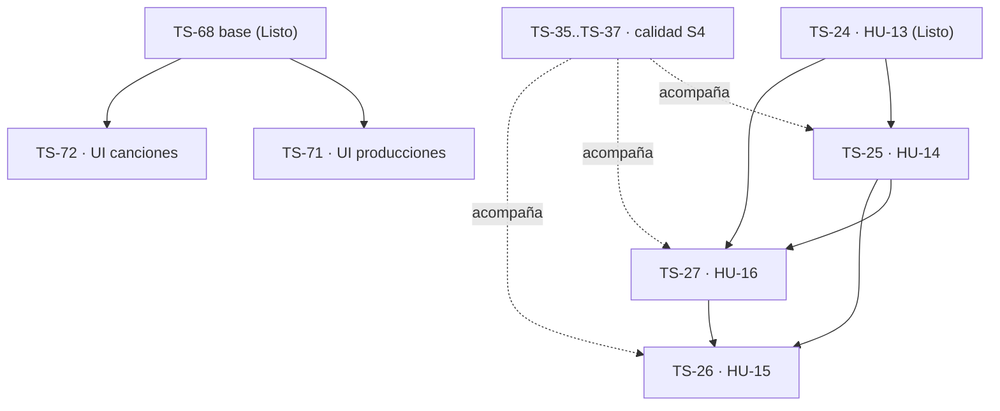

# Sprint 4 - Versiones verificadas, URLs firmadas y reproductor

**Estado:** planificado el 2026-11-03. `TS Sprint 4` (id 72) ya estaba activo en Jira desde el 2026-11-02, con el arrastre automático del S3. Jira manda sobre estado, checklist y criterios de aceptación.
**Ventana:** 2026-11-02 a 2026-11-13 (Jira cierra el 2026-11-16). **Release:** R1 - Núcleo interno (MVP). **Este sprint cierra R1** (HU-01..HU-16, 55/92 SP).
**Selección funcional:** `TS-25`, `TS-26` y `TS-27` (13 SP). **Reserva transversal:** 2 SP equivalentes para `TS-35`..`TS-37` (HU-24..HU-26), sin contar los SP dos veces.
**Tasks:** `TS-71` y `TS-72` (UI Figma), `TS-45` (tesis: diseño), `TS-46` (evidencia de desarrollo) y el arrastre del S3.
**Formato:** [campos y reglas de expansión](../backlog-format.md) · catálogo en [jira-backlog.md](../jira-backlog.md) · secuencia en [roadmap.md](../roadmap.md).

## Objetivo

Entregar en staging el ciclo completo de una versión de audio: tras la subida de HU-13, el sistema verifica el archivo contra S3 por ETag y le asigna su número secuencial inmodificable; el productor ve el historial de versiones verificadas de cada canción y reproduce cualquiera desde un reproductor embebido, servido con URLs firmadas que caducan. Con esto se cierra R1.

## Capacidad y compromiso

| Tipo                  | Alcance                                                  |                              Capacidad |
| --------------------- | -------------------------------------------------------- | -------------------------------------: |
| Historias funcionales | HU-14..HU-16                                             |                                  13 SP |
| Calidad transversal   | Avance verificable de HU-24..HU-26 sobre la superficie S4 |                      2 SP equivalentes |
| Tasks sin SP          | TS-45, TS-46, TS-71, TS-72 y arrastre del S3             | Consumen la misma capacidad del sprint |
| **Objetivo total**    | Funcional + transversal                                  |                 **15 SP equivalentes** |

TS-35..TS-37 figuran en el sprint de Jira con sus 8 SP completos porque cierran en S6. Para la velocidad del S4 solo cuentan los 13 SP de TS-25..TS-27.

## Registros del sprint

| Jira  | ID local | Tipo  |  SP | Título                                                   | Dependencias de entrega                         |
| ----- | -------- | ----- | --: | -------------------------------------------------------- | ----------------------------------------------- |
| TS-25 | ts-14    | Story |   3 | HU-14 Versionado secuencial automático                   | TS-24 (Listo)                                   |
| TS-27 | ts-16    | Story |   5 | HU-16 Servir audio mediante URLs firmadas                | TS-24 (Listo); estado `verificada` de TS-25     |
| TS-26 | ts-15    | Story |   5 | HU-15 Reproducir versiones desde la interfaz             | TS-25 (historial) y TS-27 (URL de lectura)      |
| TS-71 | ts-42    | Task  |   — | UI Figma: producciones (HU-08, HU-09)                    | TS-68 y TS-20 (Listo)                           |
| TS-72 | ts-43    | Task  |   — | UI Figma: canciones (HU-10..HU-12)                       | TS-68, TS-22 y TS-23 (Listo)                    |
| TS-45 | ts-34    | Task  |   — | Tesis: diseño de la solución (C4 2-4, ERD, persistencia) | ERD de TS-49 (Listo)                            |
| TS-46 | ts-35    | Task  |   — | Tesis: evidencia de desarrollo por sprint                | Evidencia de las entregas                       |
| TS-84 | —        | Task  |   — | Sprint Planning S4                                       | — (añadida el 2026-11-03)                       |
| TS-85 | —        | Story |   3 | Dashboard parcial del productor (alcance nuevo)          | TS-25 (Listo); añadida el 2026-11-12, roadmap «Reglas de alcance» |

## Secuencia de ejecución

Orden recomendado:

1. **Semana 1:** spec backend de TS-25 y de TS-27 en paralelo (la de TS-27 solo necesita saber qué es `verificada`). En paralelo, TS-71 y TS-72, que no tocan versiones, y el arrastre del S3.
2. Red/Green de TS-25 primero: TS-27 sirve solo versiones verificadas.
3. TS-26 empieza su spec frontend cuando las specs de TS-25 y TS-27 están aprobadas; su Red/Green necesita ambos backends.
4. TS-45 corre en paralelo y se apoya en el ERD y el ADR, no en el código del S4.

## Fronteras de alcance

Vienen del ERD §3.5 («Ciclo de vida» y «Autorización»), de D7.4/D7.6 y de `CLAUDE.md` §5; no se reabren en las specs. El reparto de la verificación es una decisión del equipo del 2026-11-03.

- **HU-14 (TS-25):** confirmación y verificación (paso 2 del ciclo de vida): el frontend envía el ETag y `duration_ms`; el Service consulta `HeadObject` mediante `HashVerifierContract` (D4.3) y pasa la fila a `verificada` (con `etag`, `verified_at`, el `size_bytes` real y `duration_ms`) o a `fallida`. Incluye el abandono de las filas `pendiente` caducadas (la spec elige entre job programado y paso perezoso; el número queda consumido) y el historial: solo versiones `verificada`, en orden cronológico, con «v{n}» cuando no hay `label`. La API no edita `version_number`, `s3_key`, `etag` ni `size_bytes`. Es la evidencia de RNF-05.
- **HU-16 (TS-27):** URL firmada de lectura (`GetObject`) de 15 minutos (D7.6), emitida en cada petición y solo para versiones `verificada` de canciones vigentes. Nunca se persiste ni se expone una URL pública permanente. Solo backend.
- **HU-15 (TS-26):** reproductor con el elemento `<audio>` nativo, abierto desde el historial de TS-25 y alimentado con la URL de TS-27. Si la URL caduca, se pide otra sin recargar la página. No ofrece descarga. Sin forma de onda ni comentarios (HU-17, S5); el estilo del prototipo es de TS-73 (S5).
- **Artista:** HU-15 y la fila RBAC de lectura de HU-16 nombran al artista, pero `production_access` sigue vetada hasta HU-20/S6. En S4 solo reproduce el productor; el artista con acceso vigente se habilita en HU-21, sin reabrir estas specs.
- **TS-71/TS-72:** solo el estilo de las pantallas ya Done, con la checklist `.01`..`.05` de TS-68..TS-70. El historial y el reproductor que este sprint añade a la canción quedan fuera de TS-72.
- **ADR 8.1:** la fila RBAC de lectura de `versions` se cierra en la spec backend de HU-16.
- **ADR 8.5** (rate limiting) y **11.5** (plan de medición de RNF) siguen ABIERTOS y diferidos de forma explícita; no bloquean.

## Condiciones de Ready

Las mismas del S3: AC vigentes en Jira, nada ABIERTO del ADR en el camino, slice del ERD aprobado (§3.5, cerrado el 2026-10-06), dentro de los vetos de `CLAUDE.md` §5 y spec de capa aprobada antes de los tests (C1). TS-42 (bucket/IAM) ya está Listo, así que S4 no tiene gate de infraestructura nuevo; la prueba de frontera real contra S3 (C4) usa ese bucket.

## Desglose funcional

Los criterios de aceptación viven en Jira. Cada historia sigue el ciclo `.01`..`.09` (HU-16 no tiene capa frontend). La comprobación en staging (`.09`) la hace el equipo y no bloquea el Done.

### TS-25 / ts-14 - HU-14 Versionado secuencial automático

- [ ] `ts-14.01` Spec backend: confirmación (ETag y `duration_ms`), verificación con `HeadObject` vía `HashVerifierContract`, paso a `verificada` o `fallida`, abandono de pendientes caducadas, historial (solo verificadas, orden, etiqueta de respaldo), inmutabilidad de `version_number`, errores D3.1 y fila RBAC.
- [ ] `ts-14.02` Tests backend en rojo: ETag coincidente y distinto, confirmación doble, versión ajena o borrada, caducidad, historial sin pendientes ni fallidas, orden, `versions_verified_complete_check` y permisos. `HeadObject` con doble del contrato y una prueba de frontera real (C4).
- [ ] `ts-14.03` Código backend hasta verde (equipo); Larastan y Pint limpios.
- [ ] `ts-14.04` Review backend con C3.
- [ ] `ts-14.05` Spec frontend: confirmación tras la subida de HU-13 (ETag de la respuesta de S3 y duración leída del archivo), estado mientras se verifica, error de verificación e historial en la canción.
- [ ] `ts-14.06` Tests frontend en rojo.
- [ ] `ts-14.07` Código frontend hasta verde (equipo).
- [ ] `ts-14.08` Review frontend con C3.
- [ ] `ts-14.09` Comprobación en staging con el bucket de TS-42 (equipo).

### TS-27 / ts-16 - HU-16 Servir audio mediante URLs firmadas

- [ ] `ts-16.01` Spec backend: endpoint de URL de reproducción, expiración de 15 min, URL nueva por petición, solo versiones `verificada`, respuesta sin datos internos del bucket, errores D3.1 (pendiente, fallida, borrada, inexistente) y fila RBAC de lectura de `versions` (ADR 8.1).
- [ ] `ts-16.02` Tests backend en rojo: expiración de 15 min, dos peticiones dan dos URLs, pendiente/fallida/borrada rechazadas, permisos del artista y del anónimo, ninguna URL pública. Firma con doble del cliente S3 y una prueba de frontera real (C4).
- [ ] `ts-16.03` Código backend hasta verde (equipo); Larastan y Pint limpios.
- [ ] `ts-16.04` Review backend con C3.
- [ ] `ts-16.09` Comprobación en staging (equipo): la URL caduca y el objeto no es accesible sin firma.

### TS-26 / ts-15 - HU-15 Reproducir versiones desde la interfaz

- [ ] `ts-15.01` Spec backend: solo lo que el reproductor necesite y no den TS-25/TS-27. Si no hace falta nada, se registra y `.02`..`.04` se cierran sin trabajo.
- [ ] `ts-15.02` Tests backend en rojo (solo si `.01` añade contrato).
- [ ] `ts-15.03` Código backend hasta verde (equipo), solo si `.01` añade contrato.
- [ ] `ts-15.04` Review backend con C3, solo si hubo tests.
- [ ] `ts-15.05` Spec frontend: reproductor desde el historial, una sola versión sonando a la vez, carga, error, URL caducada y renovada, controles accesibles por teclado (RNF-07) y sin enlace de descarga.
- [ ] `ts-15.06` Tests frontend en rojo.
- [ ] `ts-15.07` Código frontend hasta verde (equipo).
- [ ] `ts-15.08` Review frontend con C3.
- [ ] `ts-15.09` Comprobación en staging con audio real del bucket (equipo).

## Tasks y línea transversal

### TS-71 / ts-42 y TS-72 / ts-43 - Fidelidad visual con Figma (épica TS-67)

Producciones y canciones, cuyas HU quedaron Done en S3. Cada Task tiene su checklist `.01`..`.05` en Jira (inventario de marcos, enmienda de spec, tests solo donde cambia el comportamiento, código del equipo y review contra Figma). Las trampas de TS-70 aplican: revisar los marcos móviles en el inventario y `package.json` tras cualquier `shadcn add` (handoffs v32 y v33 §4). Versiones, subida y reproductor (TS-73) van en S5.

### TS-45 / ts-34 - Tesis: diseño de la solución

- [ ] `ts-34.01` C4 nivel 2 (contenedores).
- [ ] `ts-34.02` C4 nivel 3 (componentes de la API).
- [ ] `ts-34.03` C4 nivel 4 de los componentes críticos ya integrados.
- [ ] `ts-34.04` ERD aprobado y estrategia de persistencia.
- [ ] `ts-34.05` Revisión del equipo y trazabilidad al ADR.

### TS-46 / ts-35 - Evidencia de desarrollo

- [ ] `ts-35.s4.01` Objetivo, backlog comprometido y cambios de planificación del S4.
- [ ] `ts-35.s4.02` Evidencia no sensible de specs, Red/Green/Review, CI y staging por historia.
- [ ] `ts-35.s4.03` Cierre del corte S4 y de R1 con resultados, desviaciones y decisiones.

### TS-35..TS-37 - Calidad acumulativa de S4

- [ ] `ts-24.s4.01` Inventariar los componentes críticos de verificación, URLs firmadas y reproductor, y enlazar sus pruebas unitarias.
- [ ] `ts-25.s4.01` Incorporar a la matriz de integración la confirmación, el historial y la URL de reproducción, con su prueba de frontera real contra S3.
- [ ] `ts-26.s4.01` Registrar defectos críticos y altos, y levantar evidencia de RNF-02, RNF-05 y de accesibilidad del reproductor (RNF-07). Insumo del cierre de R1.

## Arrastre del S3

`TS Sprint 3` se cerró en Jira el 2026-11-03 con TS-20, TS-22, TS-23 y TS-24 en `Listo` (13 SP). Estos pendientes pasan **sin sumar SP** y se cierran en la semana 1:

| Pendiente                                              | Origen               | Bloqueo                              |
| ------------------------------------------------------ | -------------------- | ------------------------------------ |
| `ts-35.s3.01`..`.03` evidencia de tesis S3             | TS-46                | Ninguno                              |
| `ts-24.s3.01`, `ts-25.s3.01`, `ts-26.s3.01` calidad S3 | TS-35..TS-37         | Ninguno                              |
| `ts-09.09`, `ts-11.09`, `ts-12.09`, `ts-13.09` staging | TS-20, TS-22..TS-24  | Ninguno; no bloquean el Done         |
| 390 px, foco, diálogo de desactivación y backend real  | TS-70 (handoff v33 §6) | Ninguno; la Task ya está en `Listo` |

## Gates de control

### Inicio (2026-11-03)

- `TS Sprint 4` con objetivo, TS-25..TS-27 (13 SP) y las Tasks asignadas (hecho el 2026-11-03).
- Responsables de TS-25..TS-27 asignados en Jira.

### Mitad del sprint (2026-11-09)

- Specs backend de TS-25 y TS-27 aprobadas y TS-25 en verde.
- El arrastre del S3 está cerrado.
- TS-71 y TS-72 integradas o listas para integrar.

### Cierre (2026-11-13)

- TS-25, TS-26 y TS-27 cumplen la Definition of Done.
- **Cierre R1:** HU-01..HU-16 en `Listo` (55/92 SP).
- TS-46 y TS-35..TS-37 tienen la evidencia del S4.
- No quedan defectos críticos abiertos del alcance S4.

## Definition of Done del sprint

La misma del S3: specs aprobadas, tests vistos en rojo y luego en verde, C3 demostrada, review sin hallazgos abiertos, PR integrada en `develop`, CI en verde, AC de Jira y RNF aplicables verificados, documentación sin drift y handoff actualizado. La comprobación en staging (`.09`) la hace el equipo aparte y no bloquea el Done.

## Riesgos activos

| Riesgo                                          | Señal                                                        | Respuesta                                                                                                                   |
| ----------------------------------------------- | ------------------------------------------------------------ | --------------------------------------------------------------------------------------------------------------------------- |
| CORS del bucket sin verificar (handoff v33 §5)  | Configurado con `PUT`/`GET`; la subida usa POST y el reproductor puede necesitar `GET` con origen | El equipo verifica el CORS frente a D7.5 antes del Red/Green de TS-26. El agente no toca AWS (`CLAUDE.md` §0.6).            |
| El navegador no expone el ETag de S3            | La respuesta del POST no deja leer `ETag` desde JavaScript    | La spec de HU-14 define el respaldo (p. ej. `ExposeHeaders` en el CORS, a cargo del equipo, o confirmar sin ETag y comparar solo en el backend). |
| ETag ≠ MD5                                      | Subidas multipart                                            | D7.2 mantiene una sola petición: el ETag es el MD5 del objeto. Si algún día hay multipart, se reabre D7.4.                 |
| La verificación se expande a hash propio        | La spec pide calcular SHA en el cliente o en el backend       | Frontera fijada: D7.4 decide ETag + `HeadObject`; otra estrategia es una enmienda del ADR, no de la spec.                   |
| El artista entra por la puerta de HU-15/HU-16   | La spec pide permisos de artista por producción              | `production_access` sigue vetada hasta HU-20/S6; en S4 solo el productor.                                                   |
| La reserva de QA se absorbe                     | No hay evidencia de TS-35..TS-37 al corte                     | Proteger los 2 SP equivalentes y revisarlos en el cierre.                                                                   |
| TS-71/TS-72 desplazan las HU                    | Las HU van atrasadas al corte de mitad                        | Las HU tienen prioridad: cierran R1. La UI de Figma se arrastra a S5 con registro, sin recortar alcance.                    |

## Sincronización con Jira ejecutada

- [x] 2026-11-02: `TS Sprint 4` (id 72) iniciado en Jira (fin: 2026-11-16) con el arrastre automático de TS-35..TS-37 y TS-46.
- [x] 2026-11-03: objetivo del sprint registrado.
- [x] 2026-11-03: TS-25, TS-26, TS-27, TS-71, TS-72 y TS-45 movidas al sprint (13 SP funcionales verificados).
- [x] Enlaces existentes, sin cambios: TS-24 bloquea TS-25 y TS-27; TS-25 y TS-27 bloquean TS-26.
- [x] Checklists `ts-14.xx`, `ts-15.xx`, `ts-16.xx` y `ts-34.xx` añadidas a TS-25, TS-26, TS-27 y TS-45, con la frontera de alcance. AC sin cambios.
- [x] TS-71 y TS-72: ventana actualizada y casillas de código atribuidas al equipo (regla 7 de `CLAUDE.md`).
- [x] Arrastre del S3 y casillas `.s4` comentados en TS-46 y TS-35..TS-37.
- [x] 2026-11-03: creada `TS-84` (Sprint Planning S4, Task de `TS-1`) en el sprint 72, con la checklist de esta planificación.
