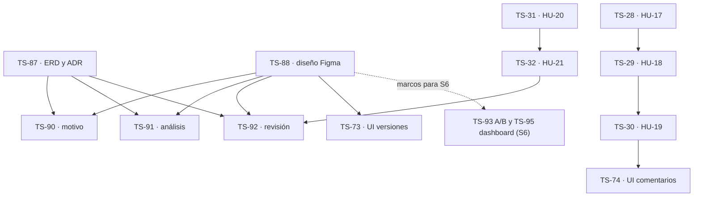

# Sprint 5 - Comentarios, acceso del artista y base del ciclo de revisión

**Estado:** planificado el 2026-11-16 al cerrar `TS Sprint 4` y **replanificado el mismo día** con la ampliación de alcance ([`ampliacion-alcance-2026-11.md`](../ampliacion-alcance-2026-11.md), aprobada por el equipo), repartida de forma equitativa entre S5 y S6. `TS Sprint 5` es el id 73. Jira manda sobre estado, checklist y criterios de aceptación.
**Ventana:** 2026-11-16 a 2026-11-29 (Jira cierra el 2026-11-30). **Release:** R2 - Beta con artista (el gate R2 sigue en S6).
**Selección funcional:** HU-17..HU-21 (`TS-28`..`TS-32`, 18 SP) y la ampliación `TS-90`, `TS-91`, `TS-92` y `TS-96` (11 SP): **29 SP**. **Reserva transversal:** 2 SP equivalentes para `TS-35`..`TS-37`, sin contar los SP dos veces.
**Tasks:** `TS-87` (ERD y ADR), `TS-88` (diseño en Figma), `TS-89` (Auth0, equipo), `TS-73` y `TS-74` (UI Figma), `TS-44` (producción, equipo), `TS-86` (Sprint Planning S5) y el arrastre del S4.
**Formato:** [campos y reglas de expansión](../backlog-format.md) · catálogo en [jira-backlog.md](../jira-backlog.md) · secuencia en [roadmap.md](../roadmap.md).

## Cierre del S4

`TS Sprint 4` (id 72) se cerró en Jira el 2026-11-16 con TS-25, TS-26, TS-27 y TS-85 en `Listo`: 13 SP de la baseline más 3 SP de alcance nuevo (16 SP). También quedaron en `Listo` TS-45, TS-46, TS-71, TS-72 y TS-84. **R1 queda cerrado:** HU-01..HU-16 en `Listo`, 55/92 SP de la baseline. TS-35..TS-37 pasaron al S5 antes del cierre, como estaba previsto (cierran en S6).

## Objetivo

Entregar en staging los comentarios con marca de tiempo, el acceso del artista y la base del ciclo de revisión: cada versión nueva explica qué cambió, trae su chequeo técnico y entra en revisión, y el artista con acceso la aprueba o pide cambios. Las pantallas nuevas se diseñan antes en Figma (incluidas las del A/B y el dashboard, que se construyen en S6), y la infraestructura de producción queda preparada.

## Capacidad y compromiso

| Tipo                  | Alcance                                                    |                              Capacidad |
| --------------------- | ---------------------------------------------------------- | -------------------------------------: |
| Historias funcionales | HU-17..HU-21                                               |                                  18 SP |
| Ampliación de alcance | TS-90, TS-91, TS-92, TS-96                                 |                                  11 SP |
| Calidad transversal   | Avance verificable de HU-24..HU-26 sobre la superficie S5  |                      2 SP equivalentes |
| Tasks sin SP          | TS-73, TS-74, TS-87, TS-88, TS-89, TS-44, TS-86 y arrastre | Consumen la misma capacidad del sprint |
| **Objetivo total**    | Funcional + ampliación + transversal                       |                 **31 SP equivalentes** |

La ampliación se reparte de forma equitativa entre S5 y S6 (decisión del equipo del 2026-11-16): unos 5 SP más por semana que hasta ahora, frente a 16 SP del S4. Para la velocidad del S5 cuentan los 29 SP de las Stories. El S6 (`TS Sprint 6`, id 74) lleva 27 SP de trabajo nuevo: HU-22, HU-23, HU-27, HU-28, `TS-93` (A/B), `TS-94` (correos) y `TS-95` (dashboard), más el cierre de HU-24..HU-26.

## Registros del sprint

| Jira  | Tipo  |  SP | Título                                                    | Dependencias de entrega                     |
| ----- | ----- | --: | --------------------------------------------------------- | ------------------------------------------- |
| TS-87 | Task  |   — | ERD y ADR de la ampliación de alcance                     | — (gate de datos de la ampliación)          |
| TS-88 | Task  |   — | Diseño en Figma: revisión, A/B, chequeo y dashboard       | Aprobación del equipo para escribir en Figma |
| TS-28 | Story |   5 | HU-17 Comentar sobre una marca de tiempo                  | TS-26 (Listo); ERD §3.6                     |
| TS-29 | Story |   5 | HU-18 Ver comentarios en la línea de tiempo               | TS-28; marcos de TS-88                      |
| TS-30 | Story |   3 | HU-19 Navegar al comentario y eliminar los propios        | TS-29                                       |
| TS-31 | Story |   3 | HU-20 Otorgar y revocar acceso del artista                | Resend (TS-43, Listo)                       |
| TS-32 | Story |   2 | HU-21 Vista restringida a producciones asignadas          | TS-31                                       |
| TS-90 | Story |   2 | Motivo de la versión                                      | TS-87; marco de TS-88                       |
| TS-91 | Story |   5 | Análisis técnico de la versión al subir                   | TS-87; marco de TS-88                       |
| TS-92 | Story |   3 | Flujo de revisión y aprobación de versiones               | TS-87, TS-32; marco de TS-88                |
| TS-96 | Story |   1 | Varios productores: autoría visible                       | TS-89 para staging                          |
| TS-73 | Task  |   — | UI Figma: versiones, subida y reproductor                 | Marcos rediseñados de TS-88                 |
| TS-74 | Task  |   — | UI Figma: comentarios (HU-17..HU-19)                      | TS-28..TS-30                                |
| TS-89 | Task  |   — | Segunda cuenta de productor en Auth0 (equipo)             | Acceso a Auth0                              |
| TS-44 | Task  |   — | Configurar producción (Railway, Vercel, Auth0) y uptime   | Accesos de producción (equipo)              |
| TS-86 | Task  |   — | Sprint Planning S5                                        | —                                           |
| TS-35..TS-37 | Story | (8) | HU-24..HU-26 calidad transversal (cierre en S6)   | Superficie entregada en S5                  |

## Secuencia de ejecución

**Primera mitad (16–22 nov)**

1. Primeros días: `TS-87` (slice del ERD y ADR) y arranque de `TS-88` con el historial y el reproductor rediseñados, el motivo, el chequeo y la revisión. Sin ellos no se especifican TS-90, TS-91 ni TS-92.
2. Spec backend de HU-17 en paralelo: su tabla ya está en el ERD §3.6 y no depende de `TS-87`.
3. Red/Green de HU-17..HU-19, TS-90 y TS-96. `TS-73` sobre los marcos nuevos.

**Segunda mitad (23–29 nov)**

4. TS-91 (análisis), HU-20 y HU-21: el artista entra, ve y comenta.
5. TS-92 (revisión) en cuanto HU-21 esté Done. `TS-74` cuando HU-19 esté Done.
6. `TS-88` termina con los marcos del A/B y del dashboard, que se construyen en S6.

`TS-44` y `TS-89` corren en paralelo a cargo del equipo; el agente no toca Railway, Vercel ni Auth0 (`CLAUDE.md` §0.6).

## Fronteras de alcance

Vienen del ERD §3.6, de D4.5, de D8.1, de `CLAUDE.md` §5 y de la propuesta aprobada; no se reabren en las specs.

- **HU-17 (TS-28):** migración `create_comments_table` según el ERD §3.6. Solo se comenta sobre versiones `verificada` de canciones vigentes. `timestamp_ms` entre 0 y `versions.duration_ms`, validado en el Service (422, D3.1). Texto obligatorio (`btrim`), autor y `created_at`. Sin estado, prioridad ni respuestas (sin RF), ni avisos dentro de la aplicación (`TS-82`). La marca se toma de la posición actual del reproductor.
- **HU-18 (TS-29):** listado por versión en orden de `timestamp_ms`, con autor y fecha, y marcadores sobre la línea de tiempo. Los controles nativos de `<audio>` no admiten marcadores: el diseño de `TS-88` y la spec frontend fijan la barra propia, que también usará el A/B en S6. Sin forma de onda ni librerías de audio.
- **HU-19 (TS-30):** el salto pasa por el mismo `resumeAt` con el que `VersionPlayer` conserva la posición al renovar la URL. Borrado físico, solo del autor. Sin edición.
- **Artista:** HU-17..HU-19 nacen solo para el productor. HU-20/HU-21 habilitan al artista con acceso vigente según las filas «✅ con acceso vigente desde HU-21» de D8.1, sin reabrir las specs anteriores. La prueba de «solo borra los suyos» usa dos productores, y luego un productor y un artista.
- **ADR 8.1:** la fila RBAC de `comments` se cierra en la spec backend de HU-17; la de las decisiones de revisión, en `TS-87`.
- **Ampliación en S5 (TS-90, TS-91, TS-92, TS-96):** según [`ampliacion-alcance-2026-11.md`](../ampliacion-alcance-2026-11.md) §5. El análisis se calcula en el navegador al subir y advierte sin bloquear; la revisión registra una fila por decisión; varios productores comparten todo el estudio. En S5 el artista decide desde el historial; la decisión desde la comparación A/B llega con `TS-93` en S6.
- **Figma:** ninguna pantalla nueva o rediseñada se especifica sin su marco aprobado en `TS-88`. `TS-73` toma los marcos rediseñados del historial y el reproductor, no los anteriores.
- **Fuera de S5:** comparación A/B (`TS-93`), correos del flujo (`TS-94`) y dashboard del proceso (`TS-95`), que van en S6. Fuera del proyecto: resumen con IA, aislamiento por productor, `TS-81` y `TS-82`. `studio_sessions` espera a HU-22/HU-23 (S6).
- **ADR 8.5** (rate limiting) y **11.5** (plan de medición de RNF) siguen ABIERTOS y diferidos; no bloquean. Los endpoints de comentarios y de decisiones quedan sin límite de peticiones mientras 8.5 siga abierto.

## Condiciones de Ready

AC vigentes en Jira; slice del ERD aprobado (§3.6 para `comments` y §3.7 para `production_access`, cerrados el 2026-10-06; `TS-87` para la ampliación); vetos levantados en `CLAUDE.md` §5 para estas historias; marco de Figma aprobado en `TS-88` para cada pantalla nueva o rediseñada; nada ABIERTO del ADR en el camino, y spec de capa aprobada antes de los tests (C1).

## Desglose funcional

Los criterios de aceptación y las checklists `.01`..`.09` viven en Jira. La comprobación en staging (`.09`) la hace el equipo y no bloquea el Done.

### TS-28 / ts-17 - HU-17 Comentar sobre una marca de tiempo

- [ ] `ts-17.01` Spec backend: migración `create_comments_table` (ERD §3.6), endpoint de creación, validación de texto y de `timestamp_ms` contra `duration_ms`, solo versiones `verificada`, autor y fecha, errores D3.1 y fila RBAC de `comments` (ADR 8.1).
- [ ] `ts-17.02` Tests backend en rojo: texto vacío, marca negativa, igual y mayor que la duración, versión pendiente, fallida o borrada, CHECK de la tabla y permisos.
- [ ] `ts-17.03` Código backend hasta verde (equipo); Larastan y Pint limpios.
- [ ] `ts-17.04` Review backend con C3.
- [ ] `ts-17.05` Spec frontend: formulario junto al reproductor, marca tomada de la posición actual, validación, envío y error.
- [ ] `ts-17.06` Tests frontend en rojo.
- [ ] `ts-17.07` Código frontend hasta verde (equipo).
- [ ] `ts-17.08` Review frontend con C3.
- [ ] `ts-17.09` Comprobación en staging (equipo).

### TS-29 / ts-18 - HU-18 Ver comentarios en la línea de tiempo

- [ ] `ts-18.01` Spec backend: listado por versión en orden de `timestamp_ms`, con autor y fecha, sin N+1; versión borrada o no verificada; permisos.
- [ ] `ts-18.02` Tests backend en rojo: orden con marcas sin orden de inserción, empates, vacío, versión borrada y permisos.
- [ ] `ts-18.03` Código backend hasta verde (equipo).
- [ ] `ts-18.04` Review backend con C3.
- [ ] `ts-18.05` Spec frontend con el marco de `TS-88`: marcadores, lista, vacío, carga, error, teclado (RNF-07) y comentario nuevo sin recargar.
- [ ] `ts-18.06` Tests frontend en rojo.
- [ ] `ts-18.07` Código frontend hasta verde (equipo).
- [ ] `ts-18.08` Review frontend con C3.
- [ ] `ts-18.09` Comprobación en staging (equipo).

### TS-30 / ts-19 - HU-19 Navegar al comentario y eliminar los propios

- [ ] `ts-19.01` Spec backend: borrado físico solo del autor, ajeno o inexistente (D3.1) y ausencia de edición.
- [ ] `ts-19.02` Tests backend en rojo.
- [ ] `ts-19.03` Código backend hasta verde (equipo).
- [ ] `ts-19.04` Review backend con C3.
- [ ] `ts-19.05` Spec frontend: salto a la marca (también tras renovar la URL), confirmación del borrado, botón solo en los propios, error y foco.
- [ ] `ts-19.06` Tests frontend en rojo, incluido el salto con URL caducada.
- [ ] `ts-19.07` Código frontend hasta verde (equipo).
- [ ] `ts-19.08` Review frontend con C3.
- [ ] `ts-19.09` Comprobación en staging (equipo).

### TS-31 / ts-20 y TS-32 / ts-21 - Acceso del artista

Checklist estándar `.01`..`.09` de `backlog-format.md`. HU-20 monta el envío de correos con Resend (invitación, D6.4), que `TS-94` reutiliza en S6. HU-21 cierra las filas «✅ con acceso vigente desde HU-21» de D8.1 para canciones, versiones y comentarios.

### Ampliación de alcance en S5 (TS-90, TS-91, TS-92, TS-96)

Cada Story lleva en Jira sus AC y su checklist `ts-amp-*.01`..`.09`. Resumen:

- **TS-90 Motivo:** categoría y texto obligatorios desde la v2; enmienda de HU-13/HU-14.
- **TS-91 Análisis:** LUFS (BS.1770), pico real, saturación, silencios y series por segundo, en un Web Worker; validado contra `ffmpeg`; advierte sin bloquear. Las series alimentan las curvas del A/B en S6.
- **TS-92 Revisión:** en revisión → aprobada o cambios pedidos; una fila por decisión; el artista decide desde el historial.
- **TS-96 Autoría:** «creado por» y «subido por» con varios productores.

## Tasks y línea transversal

### TS-87 - ERD y ADR de la ampliación

Gate de datos de la primera mitad: `productions.due_date`, `versions.change_category`, `versions.change_reason`, `versions.analysis` y la tabla de decisiones de revisión, con la fila RBAC; ADR del análisis en el cliente, umbrales del chequeo y D6.4 ampliada. Cubre también lo que necesitan `TS-94` y `TS-95` en S6. El agente redacta y el equipo aprueba.

### TS-88 - Diseño en Figma

El equipo y el agente prototipan juntos con el MCP de Figma, en una página propia del archivo «Track Studio (Copy)». Primera mitad: historial y reproductor rediseñados, motivo, chequeo técnico y revisión. Segunda mitad: comparación A/B y dashboard del proceso, que se construyen en S6.

### TS-73 / ts-44 y TS-74 / ts-45 - Fidelidad visual

`TS-73` sobre los marcos rediseñados de `TS-88`. `TS-74` en cuanto HU-19 esté Done. Aplican las trampas de TS-70..TS-72: marcos móviles y `package.json` tras cualquier `shadcn add`.

### TS-44 / ts-33 y TS-89 - Infraestructura (equipo)

Producción (Railway, Vercel y Auth0, merge a `main` con aprobación manual y monitoreo de uptime con alerta) y segunda cuenta de productor en staging.

### TS-35..TS-37 - Calidad acumulativa de S5

- [ ] `ts-24.s5.01` Inventario de los componentes críticos nuevos (validación de la marca, autorización del borrado y de la decisión, cálculo de LUFS) con sus pruebas unitarias.
- [ ] `ts-25.s5.01` Matriz de integración con los endpoints nuevos y el flujo: subir, analizar, verificar, revisar, comentar y decidir.
- [ ] `ts-26.s5.01` Ensayo integral en staging, registro de defectos críticos y altos, y evidencia de accesibilidad de los marcadores (RNF-07). Insumo del gate R2.

## Arrastre del S4

Estos pendientes pasan **sin sumar SP** y se cierran en la primera mitad:

| Pendiente                                                  | Origen                 | Bloqueo                                    |
| ---------------------------------------------------------- | ---------------------- | ------------------------------------------ |
| PR #53, #54 y #55 abiertos desde el 2026-11-02 (evidencia de calidad S2 y S3) | TS-35..TS-37 | El equipo decide integrarlos o cerrarlos |
| `ts-24.s4.01`, `ts-25.s4.01`, `ts-26.s4.01` evidencia de calidad S4 | TS-35..TS-37 | Ninguno                                  |
| Hueco de la barra móvil de `AppShell`                      | Handoff v39            | Ninguno; conviene cerrarlo junto con TS-73 |
| Correcciones de la tesis (Auth0 v7, ClickUp → Jira)        | Roadmap, discrepancias | TS-46 ya está en `Listo` (ver riesgos)     |

## Gates de control

### Inicio (2026-11-16)

- `TS Sprint 4` cerrado; `TS Sprint 5` con objetivo, 29 SP y las Tasks asignadas; `TS Sprint 6` creado con su selección (hecho).
- Responsables asignados en Jira e inicio del sprint (equipo).

### Mitad del sprint (2026-11-23)

- `TS-87` aprobada y los marcos de la primera mitad de `TS-88` aprobados.
- HU-17..HU-19, TS-90 y TS-96 Done o en review (unos 14 SP).
- El arrastre del S4 está cerrado.

### Cierre (2026-11-29)

- HU-17..HU-21, TS-90, TS-91, TS-92 y TS-96 cumplen la Definition of Done (29 SP).
- `TS-73` y `TS-74` integradas; marcos del A/B y del dashboard aprobados para S6.
- `TS-44` preparada (gate «Fin de S5» del roadmap).
- TS-35..TS-37 tienen la evidencia del S5.

## Definition of Done del sprint

La misma del S4: specs aprobadas, tests vistos en rojo y luego en verde, C3 demostrada, review sin hallazgos abiertos, PR integrada en `develop`, CI en verde, AC de Jira y RNF aplicables verificados, documentación sin drift y handoff actualizado. La comprobación en staging (`.09`) la hace el equipo aparte y no bloquea el Done.

## Riesgos activos

| Riesgo                                                   | Señal                                                              | Respuesta                                                                                                                  |
| -------------------------------------------------------- | ------------------------------------------------------------------ | -------------------------------------------------------------------------------------------------------------------------- |
| La velocidad no llega a 29 SP                            | Menos de unos 14 SP cerrados al corte de mitad                     | Si se arrastra algo a S6, recortar la ampliación de S6 desde el final: correos, luego dashboard. El alcance principal y Figma no se recortan. |
| `TS-87` o `TS-88` se retrasan                            | Sin ERD o sin marcos al tercer día                                 | Bloquean TS-90..TS-92. HU-17..HU-21 no dependen de ellos; priorizar `TS-87` el primer día.                                 |
| El LUFS no coincide con `ffmpeg`                         | La prueba de referencia de TS-91 falla fuera de tolerancia         | No se muestra el valor hasta que coincida (antiobjetivo de la propuesta); las series por banda pueden salir antes.          |
| MP3 largos agotan la memoria del navegador               | La pestaña se cae al analizar                                      | Tope de duración en la spec de TS-91; por encima, la versión se sube «sin análisis».                                       |
| Los controles nativos de `<audio>` no admiten marcadores | La spec de HU-18 propone reemplazar todo el reproductor            | El rediseño de `TS-88` resuelve la barra propia una sola vez para HU-18 y para el A/B de S6.                               |
| El salto pierde la posición al renovar la URL            | Saltar justo cuando caduca la URL deja el audio en 0               | El salto usa el mismo `resumeAt`; test con URL caducada.                                                                   |
| Varias ramas tocan `VersionPlayer`                       | Conflictos entre HU-18 y TS-73                                     | Integrar en orden: HU-18 y después TS-73. No trabajar en paralelo sobre el mismo archivo.                                  |
| Endpoints sin límite de peticiones                       | Un cliente crea comentarios o decisiones en bucle                  | ADR 8.5 sigue ABIERTO; se registra en TS-37 y se decide en S6.                                                             |
| TS-44 llega tarde a S6                                   | Sin accesos de producción al corte de mitad                        | S6 no tiene holgura. El equipo lo escala en el corte; el agente no toca la infraestructura.                               |
| La evidencia de tesis no tiene ticket abierto            | TS-46, TS-47 y TS-48 están en `Listo`, pero el roadmap las cierra en S6 | El equipo confirma si la tesis ya se entregó o si hay que reabrirlas.                                                 |

## Sincronización con Jira ejecutada

- [x] 2026-11-16: TS-35..TS-37 movidas de `TS Sprint 4` a `TS Sprint 5` (id 73).
- [x] 2026-11-16: `TS Sprint 4` (id 72) cerrado.
- [x] 2026-11-16: creada `TS-86` (Sprint Planning S5) con la checklist de esta planificación.
- [x] 2026-11-16: TS-28, TS-29, TS-30, TS-73 y TS-44 movidas al sprint; checklists y fronteras en TS-28..TS-30 y TS-73 («humano» → «equipo»); casillas `.s5` comentadas en TS-35..TS-37.
- [x] 2026-11-16 (replanificación): creadas TS-87..TS-96 con AC, SP y checklist. TS-31, TS-32 y TS-74 movidas al S5, con comentario. Notas en TS-73 (marcos rediseñados) y TS-39 (diagramas BPMN y de contexto).
- [x] 2026-11-16 (reparto equitativo): creado `TS Sprint 6` (id 74, 2026-11-30 a 2026-12-14) con HU-22, HU-23, HU-27, HU-28, TS-93, TS-94, TS-95, TS-75 y TS-76. TS-93 y TS-94 con etiqueta `target-s6` y comentario. Objetivos de ambos sprints actualizados (S5: 29 SP).
- [ ] Responsables e inicio del sprint en Jira (equipo).
