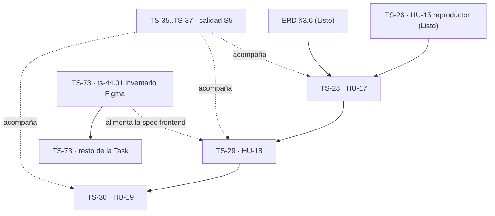

# Sprint 5 - Comentarios con marca de tiempo

**Estado:** planificado el 2026-11-16, al cerrar `TS Sprint 4` en Jira. `TS Sprint 5` (id 73) ya existía como sprint futuro. Jira manda sobre estado, checklist y criterios de aceptación.
**Ventana:** 2026-11-16 a 2026-11-27 (Jira cierra el 2026-11-30). **Release:** R2 - Beta con artista (primera mitad; el gate R2 está en S6).
**Selección funcional:** `TS-28`, `TS-29` y `TS-30` (13 SP). **Reserva transversal:** 2 SP equivalentes para `TS-35`..`TS-37` (HU-24..HU-26), sin contar los SP dos veces.
**Tasks:** `TS-73` (UI Figma: versiones, subida y reproductor), `TS-44` (producción, equipo), `TS-86` (Sprint Planning S5) y el arrastre del S4.
**Formato:** [campos y reglas de expansión](../backlog-format.md) · catálogo en [jira-backlog.md](../jira-backlog.md) · secuencia en [roadmap.md](../roadmap.md).

## Cierre del S4

`TS Sprint 4` (id 72) se cerró en Jira el 2026-11-16 con TS-25, TS-26, TS-27 y TS-85 en `Listo`: 13 SP de la baseline más 3 SP de alcance nuevo (16 SP). También quedaron en `Listo` TS-45, TS-46, TS-71, TS-72 y TS-84. **R1 queda cerrado:** HU-01..HU-16 en `Listo`, 55/92 SP de la baseline. TS-35..TS-37 pasaron al S5 antes del cierre, como estaba previsto (cierran en S6).

## Objetivo

Entregar en staging los comentarios con marca de tiempo del productor: crear un comentario en el segundo exacto de una versión verificada, verlos como marcadores sobre la línea de tiempo y en una lista ordenada, saltar desde un comentario a su punto del audio y borrar los propios. El estilo del historial y del reproductor se iguala con Figma, y la infraestructura de producción queda preparada para S6.

## Capacidad y compromiso

| Tipo                  | Alcance                                                   |                              Capacidad |
| --------------------- | --------------------------------------------------------- | -------------------------------------: |
| Historias funcionales | HU-17..HU-19                                              |                                  13 SP |
| Calidad transversal   | Avance verificable de HU-24..HU-26 sobre la superficie S5 |                      2 SP equivalentes |
| Tasks sin SP          | TS-73, TS-44, TS-86 y arrastre del S4                     | Consumen la misma capacidad del sprint |
| **Objetivo total**    | Funcional + transversal                                   |                 **15 SP equivalentes** |

Para la velocidad del S5 solo cuentan los 13 SP de TS-28..TS-30. Hito de la semana 10 (2026-11-27): HU-01..HU-19 en `Listo`, 68/92 SP.

## Registros del sprint

| Jira  | ID local | Tipo  |  SP | Título                                                   | Dependencias de entrega                              |
| ----- | -------- | ----- | --: | -------------------------------------------------------- | ---------------------------------------------------- |
| TS-28 | ts-17    | Story |   5 | HU-17 Comentar sobre una marca de tiempo                 | TS-26 (Listo); ERD §3.6 (TS-49, Listo)               |
| TS-29 | ts-18    | Story |   5 | HU-18 Ver comentarios en la línea de tiempo              | TS-28; inventario de TS-73 (`ts-44.01`)              |
| TS-30 | ts-19    | Story |   3 | HU-19 Navegar al comentario y eliminar los propios       | TS-29                                                |
| TS-73 | ts-44    | Task  |   — | UI Figma: versiones, subida y reproductor (HU-13..HU-16) | TS-68 y TS-24..TS-27 (Listo)                         |
| TS-44 | ts-33    | Task  |   — | Configurar producción (Railway, Vercel, Auth0) y uptime  | Accesos de producción (equipo)                       |
| TS-86 | —        | Task  |   — | Sprint Planning S5                                       | — (creada el 2026-11-16)                             |
| TS-35..TS-37 | ts-24..ts-26 | Story | (8) | HU-24..HU-26 calidad transversal (cierre en S6)  | Superficie entregada en S5                           |

## Secuencia de ejecución

Orden recomendado:

1. **Semana 1:** spec backend de TS-28 (migración `create_comments_table`, creación y fila RBAC de `comments`) y, en paralelo, el inventario de marcos de TS-73 (`ts-44.01`). Red/Green de TS-28 backend.
2. Spec backend de TS-29 (listado) y de TS-30 (borrado) en cuanto exista el modelo de TS-28; son endpoints pequeños y pueden ir en la misma semana.
3. Spec frontend de TS-29 con el marco de Figma del reproductor ya inventariado, para no dibujar la línea de tiempo dos veces.
4. **Semana 2:** frontends de TS-29 y TS-30, el resto de TS-73 y la evidencia transversal.
5. TS-44 corre en paralelo a cargo del equipo; el agente no toca Railway, Vercel ni Auth0 (`CLAUDE.md` §0.6).

## Fronteras de alcance

Vienen del ERD §3.6, de D4.5, de D8.1 y de `CLAUDE.md` §5; no se reabren en las specs.

- **HU-17 (TS-28):** migración `create_comments_table` según el ERD §3.6. Solo se comenta sobre versiones `verificada` de canciones vigentes. `timestamp_ms` entre 0 y `versions.duration_ms`, validado en el Service (422, D3.1), porque PostgreSQL no admite el `CHECK` entre tablas. Texto obligatorio (`btrim`), autor (`author_id`) y `created_at`. Sin `updated_at` ni `deleted_at`. Fuera: estado resuelto/pendiente, prioridad, respuestas (sin RF) y avisos (`TS-82`, post-S6). En el frontend, la marca se toma de la posición actual del reproductor.
- **HU-18 (TS-29):** listado por versión en orden de `timestamp_ms` (lo sirve el índice `comments_version_id_timestamp_ms_index`), con autor y fecha, y marcadores sobre la línea de tiempo. El reproductor de HU-15 usa los controles nativos de `<audio>`, que no admiten marcadores: la spec frontend decide cómo dibujarlos (una barra propia alineada a `duration_ms` o controles propios) sin forma de onda ni librerías de audio. Los comentarios de una versión borrada no se muestran.
- **HU-19 (TS-30):** al elegir un comentario, el reproductor salta a su marca. `VersionPlayer` vuelve a montar `<audio>` cuando renueva la URL caducada y conserva la posición con `resumeAt`: el salto debe pasar por ese mismo mecanismo. Borrado físico (D4.5 no incluye los comentarios), solo del autor. Sin edición: ni endpoint ni interfaz.
- **Artista:** HU-17 nombra al productor y al artista, pero `production_access` sigue vetada hasta HU-20/S6. En S5 solo comenta el productor; el artista con acceso vigente se habilita en HU-21, sin reabrir estas specs. La prueba de «solo borra los suyos» usa dos usuarios productores.
- **ADR 8.1:** la fila RBAC de `comments` (crear, ver, borrar) se cierra en la spec backend de HU-17, con «❌ hoy; ✅ con acceso vigente desde HU-21» para el artista, como en `songs` y `versions`.
- **TS-73:** solo el estilo de la subida, el historial y el reproductor ya Done, con la checklist `.01`..`.05`. Los marcadores y la lista de comentarios son de TS-29; su estilo de Figma es de TS-74 (S6). Elementos sin RF (notas técnicas, forma de onda) siguen fuera.
- **TS-44:** configuración de producción, a cargo del equipo. El agente la señala como dependencia y se detiene. Es el gate «Fin de S5» del roadmap.
- **ADR 8.5** (rate limiting) y **11.5** (plan de medición de RNF) siguen ABIERTOS y diferidos de forma explícita; no bloquean. El endpoint de creación de comentarios queda sin límite de peticiones mientras 8.5 siga abierto (ver riesgos).

## Condiciones de Ready

AC vigentes en Jira, slice del ERD aprobado (§3.6, cerrado el 2026-10-06), veto de `comments` levantado en `CLAUDE.md` §5 **solo para TS-28..TS-30** (esta planificación), nada ABIERTO del ADR en el camino (8.1 está PARCIAL y la fila de `comments` se cierra en la spec de HU-17) y spec de capa aprobada antes de los tests (C1). S5 no tiene gate de infraestructura nuevo para las HU.

## Desglose funcional

Los criterios de aceptación viven en Jira. Cada historia sigue el ciclo `.01`..`.09`. La comprobación en staging (`.09`) la hace el equipo y no bloquea el Done.

### TS-28 / ts-17 - HU-17 Comentar sobre una marca de tiempo

- [ ] `ts-17.01` Spec backend: migración `create_comments_table` (ERD §3.6), endpoint de creación sobre una versión, validación de texto y de `timestamp_ms` contra `duration_ms`, solo versiones `verificada` de canciones vigentes, respuesta con autor y fecha, errores D3.1 y fila RBAC de `comments` (ADR 8.1).
- [ ] `ts-17.02` Tests backend en rojo: texto vacío o solo espacios, marca negativa, igual y mayor que la duración, versión pendiente, fallida, borrada o ajena, autor y fecha registrados, CHECK de la tabla y permisos (artista y anónimo).
- [ ] `ts-17.03` Código backend hasta verde (equipo); Larastan y Pint limpios.
- [ ] `ts-17.04` Review backend con C3.
- [ ] `ts-17.05` Spec frontend: formulario de comentario junto al reproductor, marca tomada de la posición actual, validación del texto, envío, error y estado mientras se guarda.
- [ ] `ts-17.06` Tests frontend en rojo.
- [ ] `ts-17.07` Código frontend hasta verde (equipo).
- [ ] `ts-17.08` Review frontend con C3.
- [ ] `ts-17.09` Comprobación en staging con una versión verificada real (equipo).

### TS-29 / ts-18 - HU-18 Ver comentarios en la línea de tiempo

- [ ] `ts-18.01` Spec backend: listado por versión en orden de `timestamp_ms`, con autor y fecha, sin N+1; versión borrada o no verificada; permisos.
- [ ] `ts-18.02` Tests backend en rojo: orden con marcas sin orden de inserción, empate de marcas, versión sin comentarios, versión borrada y permisos.
- [ ] `ts-18.03` Código backend hasta verde (equipo); Larastan y Pint limpios.
- [ ] `ts-18.04` Review backend con C3.
- [ ] `ts-18.05` Spec frontend: marcadores sobre la línea de tiempo (decisión sobre los controles nativos), lista ordenada, vacío, carga y error, marcadores accesibles por teclado (RNF-07) y alta de un comentario nuevo sin recargar. Usa el inventario de `ts-44.01`.
- [ ] `ts-18.06` Tests frontend en rojo.
- [ ] `ts-18.07` Código frontend hasta verde (equipo).
- [ ] `ts-18.08` Review frontend con C3.
- [ ] `ts-18.09` Comprobación en staging (equipo).

### TS-30 / ts-19 - HU-19 Navegar al comentario y eliminar los propios

- [ ] `ts-19.01` Spec backend: borrado físico solo del autor, respuesta ante comentario ajeno o inexistente (D3.1) y ausencia de edición.
- [ ] `ts-19.02` Tests backend en rojo: el autor borra, otro productor no puede, inexistente, versión borrada, no hay ruta de edición y permisos.
- [ ] `ts-19.03` Código backend hasta verde (equipo); Larastan y Pint limpios.
- [ ] `ts-19.04` Review backend con C3.
- [ ] `ts-19.05` Spec frontend: salto del reproductor a la marca (también tras renovar la URL), confirmación del borrado, botón solo en los propios, error y foco tras borrar.
- [ ] `ts-19.06` Tests frontend en rojo.
- [ ] `ts-19.07` Código frontend hasta verde (equipo).
- [ ] `ts-19.08` Review frontend con C3.
- [ ] `ts-19.09` Comprobación en staging (equipo).

## Tasks y línea transversal

### TS-73 / ts-44 - UI Figma: versiones, subida y reproductor

Checklist `.01`..`.05` en Jira (inventario de marcos, enmienda de spec, tests solo donde cambia el comportamiento, código del equipo y review contra Figma). `ts-44.01` va en la semana 1 porque alimenta la spec frontend de HU-18. Las trampas de TS-70..TS-72 aplican: revisar los marcos móviles y `package.json` tras cualquier `shadcn add`.

### TS-44 / ts-33 - Producción (equipo)

Railway, Vercel y Auth0 de producción sin secretos en el repo, merge a `main` con aprobación manual y monitoreo de uptime con alerta (RNF-04). Lo ejecuta el equipo; la condición del roadmap es que llegue preparado al cierre del S5.

### TS-35..TS-37 - Calidad acumulativa de S5

- [ ] `ts-24.s5.01` Incorporar al inventario los componentes críticos de comentarios (validación de la marca, autorización del borrado, línea de tiempo y salto) y enlazar sus pruebas unitarias.
- [ ] `ts-25.s5.01` Incorporar a la matriz de integración los endpoints de comentarios y el flujo completo: subir, verificar, reproducir, comentar, listar, saltar y borrar.
- [ ] `ts-26.s5.01` Ensayo integral en staging, registro de defectos críticos y altos, y evidencia de accesibilidad de los marcadores (RNF-07). Insumo del gate R2.

## Arrastre del S4

Estos pendientes pasan **sin sumar SP** y se cierran en la semana 1:

| Pendiente                                                  | Origen               | Bloqueo                                    |
| ---------------------------------------------------------- | -------------------- | ------------------------------------------ |
| PR #53, #54 y #55 abiertos desde el 2026-11-02 (evidencia de calidad S2 y S3) | TS-35..TS-37 | El equipo decide integrarlos o cerrarlos |
| `ts-24.s4.01`, `ts-25.s4.01`, `ts-26.s4.01` evidencia de calidad S4 | TS-35..TS-37 | Ninguno                                |
| Hueco de la barra móvil de `AppShell`                      | Handoff v39          | Ninguno; conviene cerrarlo junto con TS-73 |
| Correcciones de la tesis (Auth0 v7, ClickUp → Jira)        | Roadmap, discrepancias | TS-46 ya está en `Listo` (ver riesgos)   |

## Gates de control

### Inicio (2026-11-16)

- `TS Sprint 4` cerrado y `TS Sprint 5` con objetivo, TS-28..TS-30 (13 SP) y las Tasks asignadas.
- Responsables de TS-28..TS-30 asignados en Jira (equipo).

### Mitad del sprint (2026-11-23)

- Spec backend de TS-28 aprobada y TS-28 backend en verde; specs backend de TS-29 y TS-30 aprobadas.
- `ts-44.01` (inventario de Figma) hecho.
- El arrastre del S4 está cerrado.

### Cierre (2026-11-27)

- TS-28, TS-29 y TS-30 cumplen la Definition of Done: HU-01..HU-19 en `Listo` (68/92 SP).
- TS-44 preparada (gate «Fin de S5» del roadmap).
- TS-35..TS-37 tienen la evidencia del S5.
- No quedan defectos críticos abiertos del alcance S5.

## Definition of Done del sprint

La misma del S4: specs aprobadas, tests vistos en rojo y luego en verde, C3 demostrada, review sin hallazgos abiertos, PR integrada en `develop`, CI en verde, AC de Jira y RNF aplicables verificados, documentación sin drift y handoff actualizado. La comprobación en staging (`.09`) la hace el equipo aparte y no bloquea el Done.

## Riesgos activos

| Riesgo                                                   | Señal                                                              | Respuesta                                                                                                                  |
| -------------------------------------------------------- | ------------------------------------------------------------------ | -------------------------------------------------------------------------------------------------------------------------- |
| Los controles nativos de `<audio>` no admiten marcadores | La spec de HU-18 propone reemplazar todo el reproductor            | Preferir una barra propia alineada a `duration_ms`; reemplazar los controles obliga a rehacer los tests de HU-15 y su accesibilidad. |
| El salto pierde la posición al renovar la URL            | Saltar justo cuando caduca la URL deja el audio en 0               | El salto usa el mismo `resumeAt` del remontaje; test con URL caducada en `ts-19.06`.                                       |
| El artista entra por la puerta de HU-17                  | La spec pide permisos de artista por producción                    | `production_access` sigue vetada hasta HU-20/S6; en S5 solo el productor.                                                  |
| Comentarios sin límite de peticiones                     | Un cliente crea comentarios en bucle                               | ADR 8.5 sigue ABIERTO; se registra en TS-37 como hallazgo y se decide en S6, sin bloquear S5.                              |
| TS-73 y HU-18 tocan el mismo reproductor                 | Conflictos en `VersionPlayer` entre dos ramas                      | `ts-44.01` primero; el código de TS-73 se integra antes o después de HU-18, no en paralelo sobre el mismo archivo.         |
| TS-44 llega tarde a S6                                   | Sin accesos de producción al corte de mitad                        | S6 no tiene holgura (roadmap). El equipo lo escala en el corte de mitad; el agente no toca la infraestructura.             |
| La evidencia de tesis no tiene ticket abierto            | TS-46, TS-47 y TS-48 están en `Listo`, pero el roadmap las cierra en S6 | El equipo confirma si la tesis ya se entregó o si hay que reabrirlas para S5 y S6.                                     |
| La reserva de QA se absorbe                              | No hay evidencia de TS-35..TS-37 al corte                          | Proteger los 2 SP equivalentes y revisarlos en el cierre.                                                                  |

## Sincronización con Jira ejecutada

- [x] 2026-11-16: TS-35..TS-37 movidas de `TS Sprint 4` a `TS Sprint 5` (id 73).
- [x] 2026-11-16: `TS Sprint 4` (id 72) cerrado.
- [x] 2026-11-16: creada `TS-86` (Sprint Planning S5, Task de `TS-1`) en el sprint 73, con la checklist de esta planificación.
- [x] 2026-11-16: objetivo y fechas del `TS Sprint 5` registrados (2026-11-16 a 2026-11-30).
- [x] 2026-11-16: TS-28, TS-29, TS-30, TS-73 y TS-44 movidas al sprint (13 SP funcionales).
- [x] Checklists `ts-17.xx`, `ts-18.xx` y `ts-19.xx` añadidas a TS-28, TS-29 y TS-30, con la frontera de alcance. AC sin cambios.
- [x] TS-73: casilla de código atribuida al equipo (regla 7 de `CLAUDE.md`), ventana S5 y frontera con TS-29.
- [x] Casillas `.s5` y arrastre del S4 comentados en TS-35..TS-37.
- [ ] Inicio del sprint en Jira (equipo).
